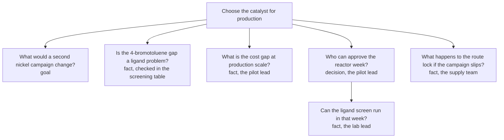

# The production grill

This is the grill case for the chemistry fixture. The task pages walk the task skills; this page walks one grill after the pilot. The grill is with the pilot lead — the person the decision is for — and it ends with a production map, a testimony, one glossary term, and one ADR.

The scratch project is under `waymark/`. `waymark validate --project waymark` reports no findings. The pieces the grill produced are:

- [Production map](waymark/work/map/wm-pr0d8c4a2e9s.md): choose the catalyst for production.
- [Testimony](waymark/work/testimony/wm-gr1k7c4a2e9s.md): the question tree and what the pilot lead said.
- [Glossary source](waymark/glossary/frank.jsonl): the term `route lock`.
- [ADR](waymark/docs/adr/0001-palladium-for-production.md): palladium for the production scale-up.

## Why a new map

The catalyst root map is closed. The production decision is not a child of the pilot map: the pilot map's target was the 5 L run, and a closed map does not gain a child when a later decision appears. The caller opens a new root map for the production decision, opens the testimony, and links the two.

That is the division the grill skill keeps: the caller owns the map and the work tree; the grill owns the discussion and the record of it.

## The subject

The production map's target is to decide whether the scale-up keeps palladium or waits for a nickel ligand campaign. The grill states the subject in one sentence before the first question:

> Choose the catalyst for production.

The subject is the root of the question tree. It is not a question the pilot lead answers directly; it is the thing the questions refine.

## The question tree

The full tree; round 1 asks every leaf except the one that waits on the approval:



The screening question is a fact the agent can check. The cost, the route lock, and the lab's ligand inventory are facts the people in the room know. The approval is the pilot lead's decision.

The child under the approval is a narrower question. It is in the tree, but round 1 does not ask it: the approval answer decides which week the lab can use.

## Round 1

The askable set is every leaf whose children are settled. The grill asks the whole set in one round, numbers each question, and gives a recommended answer.

| Question | Recommendation | Answer |
| --- | --- | --- |
| What would a second nickel campaign change? | It would test whether another ligand closes the 4-bromotoluene gap; if it does, nickel cuts the catalyst cost by about 90%. | The pilot lead agrees: a positive campaign changes the cost case; a negative one keeps palladium. |
| Is the 4-bromotoluene gap a ligand problem? | I can check the protocol and the screening table before asking you. | The screen used dtbbpy and never tried another ligand; 4-bromotoluene is 64% and 2-bromonaphthalene 41%, both under the 70% floor. The data cannot separate the ligand from the substrate. |
| What is the cost gap at production scale? | Palladium is the largest cost line; nickel is about a tenth of the catalyst cost. | The pilot lead confirms the order of magnitude. |
| Who can approve the reactor week? | The pilot lead can approve one week, but the route lock is the real constraint. | The pilot lead can approve the week; the supply team needs the route locked by 15 December. |
| What happens to the route lock if the campaign slips? | A slip moves the supply order and the plant slot. | Missing 15 December pushes both; the route lock moves with the campaign. |

The answers settle every question except the one under the approval, which waits for the approval answer. The grill does not decide at the end of round 1; it computes the next askable set.

## Round 2

The question the approval unblocked:

> Can the ligand screen run in that week?

The lab lead's answer is no: the ligand is not in the lab, and ordering it takes two weeks. The week is not enough.

That settles the tree. The grill puts the decision to the pilot lead:

> Do we lock palladium now, or delay the route for the nickel campaign?

The pilot lead chooses palladium for production. The nickel ligand work continues in R&D; it is not a production dependency. The decision is recorded in the map and the ADR, not in the testimony alone.

One piece of work leaves the grill:

```text
- work: Test the nickel ligand on 4-bromotoluene in R&D (the caller creates the probe task; it is outside the production map).
```

The grill does not create the R&D task. The caller does, in the R&D tree.

## What the grill wrote

| Artifact | What it holds | Where |
| --- | --- | --- |
| Map | The production decision and its acceptance direction; the map is closed. | [wm-pr0d8c4a2e9s](waymark/work/map/wm-pr0d8c4a2e9s.md) |
| Testimony | The question tree and the discussion, one update per round; closed when the askable set was empty. | [wm-gr1k7c4a2e9s](waymark/work/testimony/wm-gr1k7c4a2e9s.md) |
| Glossary | `route lock`: the date the production route is fixed with the supply team; after it, changing the catalyst reopens the route. | [frank.jsonl](waymark/glossary/frank.jsonl) |
| ADR | Palladium for production, with the pilot evidence, the nickel shortfall, and the route-lock trade-off. | [ADR 0001](waymark/docs/adr/0001-palladium-for-production.md) |
| Work | The R&D probe, as a `work:` line; the caller creates the task. | [Testimony](waymark/work/testimony/wm-gr1k7c4a2e9s.md) |

The ADR links back to the owning map and the testimony. The map links to the testimony. The testimony has a soft link to the map. That is the link chain the three skills ask for.

The production map's review point asks for the ADR, the pilot record, and the screening table. The ADR names palladium and the evidence, so the map closes.

The glossary source is committed. `GLOSSARY.md` is generated and ignored; run the bundle's `merge` command to rebuild it.

## What the case showed

All three branch artifacts exist: the testimony, the glossary term, and the ADR. The map's decision names the evidence a reader can check. The grill did not write the map decision; the caller did.

The work hand-off is the weakest part of the fixture. The testimony holds the `work:` line, but the R&D task is outside the scratch project, so the caller's creation of it was not exercised. A full test would add the R&D map and task and link the testimony to the task; this case stops at the hand-off.

The testimony appears in `waymark tree` as a root record. It is not a target node and has no parent; the tree lists every category, so a record with no parent shows up beside the maps. The target tree is the map/task run under the catalyst root, not the testimony.

The production map is a new root, not a child of the closed catalyst root. That is the correct shape for a later decision: a closed map does not gain a child, and the production decision has its own target and acceptance direction.

The case did not exercise the standalone grill path, where there is no work item and the testimony has no map to link. The grill map wording check fixed the link rule to say "when there is one"; this case uses the linked path.

## Before the case: the grill map wording check

The grill map's wording check ran before this case. It found two conflicts, both fixed:

- The grill map and the ADR map carried a `## Review` section. At the time, `map-review` and `update` said that a map had no `## Review` section and its status was the verdict, so the sections were removed. The later map-review design adds a Review section; this describes the earlier rule and what the run actually did, not the new rule.
- The testimony link rule said "link it to the discussion's work item" without allowing a standalone grill. The rule now says "when there is one" in both `SKILL.md` and `testimony.md`.

The grill map itself is still open on the glossary branch. That is a completeness gap, not a wording conflict: the glossary setup and cleanup tasks are not finished. This case does not depend on the glossary map being closed; the chemistry fixture has its own glossary source.

## Files

- [Production map](waymark/work/map/wm-pr0d8c4a2e9s.md)
- [Testimony](waymark/work/testimony/wm-gr1k7c4a2e9s.md)
- [Glossary source](waymark/glossary/frank.jsonl)
- [ADR](waymark/docs/adr/0001-palladium-for-production.md)
- [Screening table](waymark/lab/screening-table.csv)
- [Pilot record](waymark/lab/pilot-record.md)
